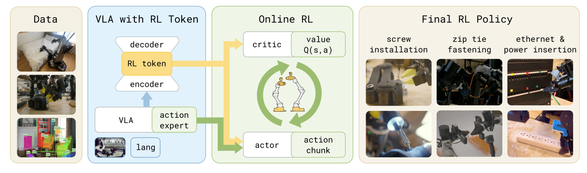
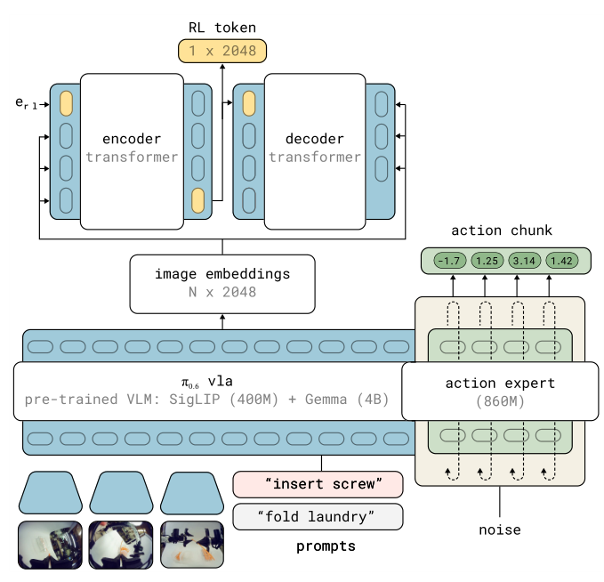
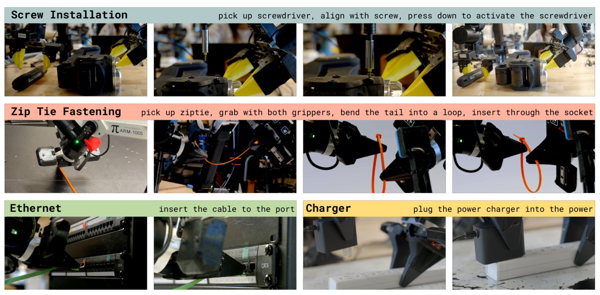
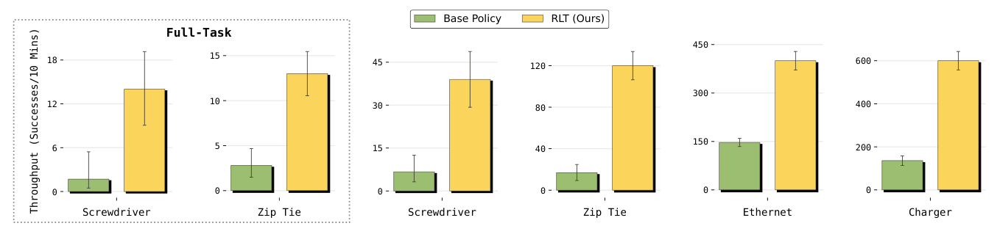
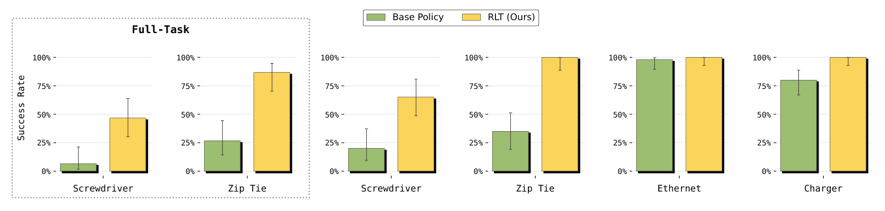
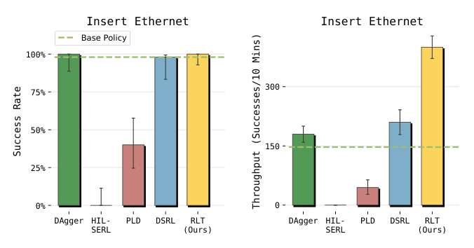
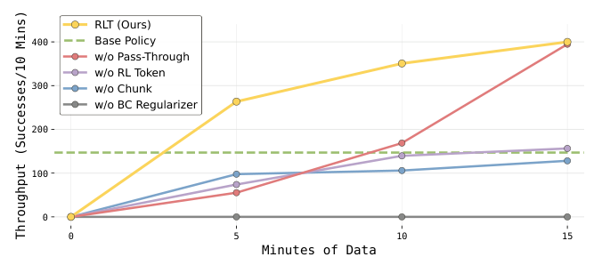
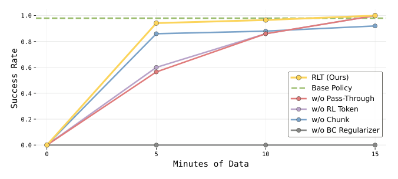
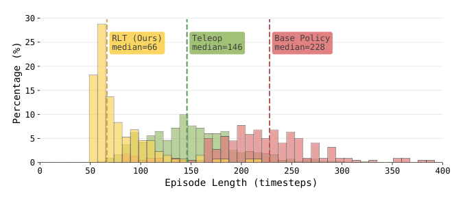

# RL Token: Bootstrapping Online RL with Vision-Language-Action Models

> **论文精读讲解**（Physical Intelligence, arXiv:2604.23073v2 [cs.LG], 30 Apr 2026）
> 原文 PDF：[2604.23073v2.pdf](./2604.23073v2.pdf) ｜ 项目页：<https://pi.website/research/rlt>
> 作者：Charles Xu, Jost Tobias Springenberg, Michael Equi, Ali Amin, Adnan Esmail, Sergey Levine, Liyiming Ke

---

## 目录

- [0. 一句话总结](#0-一句话总结)
- [1. 问题背景：VLA 卡在"最后的一毫米"](#1-问题背景vla-卡在最后的一毫米)
- [2. 方法总览：一个"分工"式的配方](#2-方法总览一个分工式的配方)
- [3. 核心组件一：RL Token 是怎么造出来的](#3-核心组件一rl-token-是怎么造出来的)
- [4. 核心组件二：在线 RL 精修动作块](#4-核心组件二在线-rl-精修动作块)
- [5. 完整系统：从采集到更新的工程细节](#5-完整系统从采集到更新的工程细节)
- [6. 实验设置：四个"亚毫米"任务](#6-实验设置四个亚毫米任务)
- [7. 实验结果：四个问题的答案](#7-实验结果四个问题的答案)
- [8. 消融：每个设计选择都重要](#8-消融每个设计选择都重要)
- [9. 与相关工作的定位](#9-与相关工作的定位)
- [10. 为什么它有效：机制层面的解读](#10-为什么它有效机制层面的解读)
- [11. 局限、可疑点与延伸思考](#11-局限可疑点与延伸思考)
- [12. 超参与关键数字速查表](#12-超参与关键数字速查表)
- [13. 与 StarVLA 的对照与复现清单](#13-与-starvla-的对照与复现清单)

---

## 0. 一句话总结

**把冻结的 VLA 内部表征"蒸馏"成一个 1×2048 的紧凑向量（RL Token），再在这个向量上挂一个两层 MLP 的 actor-critic 做 off-policy 在线 RL，用 VLA 的动作块作为参考动作 + 行为克隆正则把 RL 变成"局部动作微调"——于是几十分钟到几小时的真机练习就能把插螺丝、扎扎带、插网线这类亚毫米精度任务的成功率与速度显著拉起来，某些阶段甚至超过人类遥操作速度。**

一句话版本：**VLA 负责"看懂 + 给个好起点"，小 actor-critic 负责"把最后几毫米磨快磨准"。**

---

## 1. 问题背景：VLA 卡在"最后的一毫米"

### 1.1 现象

通用 VLA（ Vision-Language-Action）模型能从大规模演示数据里学到五花八门的操作技能，但在**执行的最后阶段**常常掉链子：

- 动作**慢**（动一下就停下来确认，反复微调）；
- 需要**停顿 + 重试**才能成功（典型如接触前的"试探性戳一戳"）；
- 精密任务关键阶段的**小误差会累积**成失败。

根因是行为克隆的性质：策略的上限被演示数据的质量与覆盖度锁死。当演示本身抖动、不一致时（人手遥操作插网线就是如此），"精确、果断"这种策略根本不在数据分布里。

### 1.2 三条现成路线都不够用

| 路线 | 代表 | 问题 |
|---|---|---|
| 全模型 RL 微调 | RECAP / PPO 系 | 需要大规模数据，billion 参数模型在线更新既贵又样本低效，**几小时真机时间内跑不出一版改进策略** |
| 小模型真机 RL | SERL / HIL-SERL / RL100 | 几小时能学会，但**从零开始训小策略 + ResNet 视觉编码器**，彻底放弃了 VLA 的泛化与行为先验 |
| 冻结 VLA + 小模块 | ConRFT / Policy Decorator / PLD / DSRL | 方向对，但多数是**单步动作**上的残差/噪声调制：稀疏奖励下信用分配的地平线太长；或在扩散噪声空间里隐式搜索，改进幅度受限 |

于是论文抛出中心问题：

> **如何既保留 VLA 的泛化能力，又拿到轻量在线 RL 的样本效率？**

### 1.3 论文的核心洞察

> 不要在 VLA 上学 RL，也不要抛开 VLA 学 RL——**把 VLA 的内部表征压成一个 RL 可以直接消费的接口**。

这个接口就是 **RL Token（RLT）**：一个从 VLA 最后一层 token 嵌入里读出来的紧凑向量（1×2048），它承担三个职责：

1. **状态表征**：给 actor/critic 当 observation（保留预训练的任务相关知识）；
2. **参考动作来源**：VLA 仍然产出动作块，作为 actor 的输入与正则目标；
3. **探索先验**：把探索约束在 VLA 动作分布附近，RL 只做"局部动作编辑"。

---

## 2. 方法总览：一个"分工"式的配方



*Fig. 1：往 VLA 里插入一个 "RL Token"——用 encoder/decoder 从 VLA 内部特征里学出紧凑且有意义的表征；随后在这个表征上训练轻量 actor-critic 做在线 RL，几小时甚至几分钟的真机经验即可精调出高精度任务策略。*

整个 pipeline 分两大阶段：

```
阶段 A：Adapting the VLA to expose an RL interface（离线，几小时）
  task demos ──► 联合训练 {RL token 的 encoder-decoder} + {（可选）SFT 微调 VLA}
  产物：冻结的 VLA θ_vla  +  冻结的 RL token 模块 φ

阶段 B：Online RL to refine VLA action chunks（在线，几十分钟~几小时）
  warmup 用 VLA 滚 N_warm 步填满 replay buffer
  循环：真机 rollout → 存 transition → off-policy actor-critic 更新（UTD=5）
  产物：轻量 actor π_θ + critic Q_ψ
```

一句话拆解分工：**冻结的 VLA 提供感知、动作建议与探索锚点；轻量 actor/critic 只负责在关键阶段把策略磨到成功与快速。**

---

## 3. 核心组件一：RL Token 是怎么造出来的



*Fig. 2：RLT 在预训练 VLA 上附加一个 encoder-decoder transformer，产出 VLA 表征的压缩嵌入（RL token），从而支撑在线 RL 阶段的数据与参数高效微调。*

### 3.1 动机：为什么不能直接用 VLA 的隐状态？

直接把 RL 接到 VLA 上不现实，原因有三：

- VLA 是 **billion 参数**级模型，在线更新又贵又低效；
- transformer 每层嵌入都是**高维**的，到底哪一层、哪些 token 构成"对 RL 好的表征"并不显然；
- 但又**不能不利用**——这些表征是在 web + 机器人大数据上训出来的，本身就含大量对生成动作有用的信息。

所以目标变成：**把 VLA 表征压成一个既保留任务相关信息、又足够小到能被轻量 actor-critic 消费的嵌入。**

### 3.2 做法：一个自编码器瓶颈（autoencoding bottleneck）

设预训练 VLA 对状态 $s$ 与语言指令 $\ell$ 产出最后一层 token 嵌入：

$$z = f(s,\ell;\theta_{vla}), \qquad z_{1:M} = \{z_1,\dots,z_M\}$$

每个 $z_i$ 对应一个输入 token 的嵌入。然后：

1. 在序列尾部**追加一个可学习 embedding** $e_{rl} = e_\phi(\texttt{<rl>})$；
2. 用一个轻量 encoder transformer $g_\phi$ 处理增广序列，**取特殊 token 位置的输出作为 RL Token**：

$$z_{rl} = g_\phi\big([z_{1:M},\, e_{rl}]\big)_{M+1}$$

3. 用一个 decoder transformer $d_\phi$（+ 线性输出头 $h_\phi$）**自回归地重建原始 VLA 嵌入**。记 $\bar z_i = \mathrm{sg}(z_i)$（stop-gradient），重建目标为：

$$\mathcal{L}_{ro} = \mathbb{E}_{\mathcal{D}}\Big[\sum_{i=1}^{M}\big\| h_\phi\big(d_\phi([z_{rl}, \bar z_{1:i-1}])\big)_i - \bar z_i \big\|_2^2\Big]$$

4. 训练时 VLA 视作冻结（关于 $\mathcal{L}_{ro}$ 不求梯度），并**可选地**叠加 VLA 的监督微调 $\mathcal{L}_{vla}$：

$$\phi,\theta_{vla} = \arg\min_{\phi,\theta_{vla}} \; \mathcal{L}_{ro}(\phi) + \alpha\,\mathcal{L}_{vla}(\theta_{vla})$$

之后 $\theta_{vla}$ 与 $\phi$ **全部冻结**，在线 RL 只在 $z_{rl}$ 上做。

> 论文脚注说明：实验中每个任务的语言指令是固定的，所以这一步丢掉了语言嵌入；该构造对一般 VLA 嵌入同样适用。

### 3.3 为什么"重建"能逼出好表征

这是典型的**信息瓶颈**逻辑：

- decoder 必须仅凭 $z_{rl}$ 就能重建 VLA 的全部 token 嵌入 ⇒ $z_{rl}$ 被迫成为 VLA 表征的**充分统计量**（sufficient statistic）；
- 但 $z_{rl}$ 只有 1×2048 维 ⇒ 学到的必然是"生成动作真正需要的那部分结构"，噪声被挤掉；
- stop-gradient 保证这只是一个**读出（readout）**操作，不会反向污染 VLA 的表征（VLA 只被 $\mathcal{L}_{vla}$ 可选地影响）。

效果上，这相当于**把一个 4B+ 的 VLM 的"任务相关summary"压成一个向量，交给一个 MLP**。第 8 节的消融显示：换成 ImageNet 预训练的 ResNet-10 编码器，吞吐直接掉 50% —— 说明这个 token 里确实编码了通用视觉编码器给不出的"操作相关结构"。

**基础模型细节**：底层 VLA 是 **π0.6**，由预训练 VLM（SigLIP 400M + Gemma 4B）+ action expert（860M）组成；RL Token 的维度 2048 与 Gemma 的隐宽对齐。

---

## 4. 核心组件二：在线 RL 精修动作块

阶段 A 结束后，VLA 与 RL token 都冻结。此时训练一对轻量网络：actor $\pi_\theta$ 与 critic $Q_\psi$。

**统一的状态输入**（把 RL token 与本体感受拼接，补齐闭环控制所需信息）：

$$x = (z_{rl},\; s_p)$$

其中 $s_p$ 是本体感受状态（proprioceptive state；螺丝任务用关节位置，扎带/网线/充电器任务用末端位姿）。

### 4.1 Critic：动作块上的 off-policy TD

critic 直接对**动作块**估值 $Q_\psi(x, a_{1:C}) \in \mathbb{R}$，在 replay buffer $\mathcal{B}$ 上做标准 off-policy 时序差分：

$$\mathcal{L}_Q = \mathbb{E}_{(x,a_{1:C},x')\sim\mathcal{B}}\Big[\big(\hat Q - Q_\psi(x,a_{1:C})\big)^2\Big]$$

$$\hat Q = \sum_{t'=1}^{C}\gamma^{t'-1}r_{t'} + \gamma^{C}\,\mathbb{E}_{a'\sim\pi_\theta}\big[Q_{\psi'}(x', a')\big]$$

实践中跟 **TD3** 一致：双 Q 集成 + 取最小值算 target，$\psi'$ 是 target network 参数。

**这里最关键的设计是"动作块级别的价值备份"**：因为一次 bootstrap 跨 $C$ 步，稀疏的成功奖励只需要跨过 $T/C$ 个决策点就能传播到起点，而不是 $T$ 步。这是 RLT 能在稀疏奖励 + 50 Hz 下学会的**根本原因之一**（第 8 节：改成单步 $C=1$ 直接学不动）。

### 4.2 Actor：条件于 VLA 参考动作的高斯策略

$$\pi_\theta\big(a_{1:C} \mid x, \tilde a_{1:C}\big) = \mathcal{N}\Big(\mu_\theta\big(x, \tilde a_{1:C}\big),\; \sigma^2 I\Big)$$

输入里显式带上 VLA 采样的参考动作块 $\tilde a_{1:C} \sim \pi_{vla}(\cdot\mid s,\ell)$，有两个好处：

1. **不从头学**：actor 直接看到 VLA 的强初始提案，在线 RL 变成对提案的微调；
2. **保留多模态**：VLA 的动作分布是多模态的（扩散/flow 采样），而 actor 是单峰高斯；把**已经采样出来的那一支**作为输入，等于把 mode 信息"喂"给了单峰策略——否则高斯根本表达不出来（论文引用 Flow Q-learning 的观点）。

### 4.3 策略正则：把 RL 变成"局部动作编辑"

$$\mathcal{L}_\pi(\theta) = \mathbb{E}_{\substack{s\sim\mathcal{B}\\ a_{1:C}\sim\pi_\theta}}\Big[-\,Q_\psi(x,a_{1:C}) \;+\; \beta\,\big\|a_{1:C} - \tilde a_{1:C}\big\|_2^2\Big]$$

- 第一项：最大化 critic 价值；
- 第二项：**向 VLA 参考动作靠拢**（本质是固定方差高斯下的 KL 正则，思想上等价于 KL-regularized RL / MPO / AWAC 那一族）。

$\beta$ 控制"敢偏离 VLA 多少"。它把在线 RL 从"在高维动作块空间里无约束搜索"变成"围绕 VLA 动作分布的局部编辑"——这既稳定了训练，也把探索限制在了合理区域。

### 4.4 Reference action dropout：防止 actor 变"复读机"

参考动作条件化有一个很实际的失败模式：**actor 直接抄 $\tilde a$，不学着改进它**。在 critic 还没给出有用信号之前尤其容易——因为"条件化在 $\tilde a$ 上"和"正则向 $\tilde a$"两件事都在鼓励它留在原地。

解法很朴素：**训练时对每个 batch 里的随机一部分 transition，把参考块置零**再喂给 actor。这样就强制 actor 保留一条**独立的动作生成通路**；而当参考块存在时，它仍然能利用 VLA 的动作分布。

论文观察到：一旦 critic 给出有用信号，actor 会**自然地**在"偏离参考能提高价值"时偏离。

> 工程细节：dropout 比例 **50%**，且**只在训练时**做；**推理时永远提供参考动作**。

---

## 5. 完整系统：从采集到更新的工程细节

论文 Algorithm 1 的完整循环：

```text
1: 训练 RL token（并可选微调 VLA）
     z_i = f_i(s, ℓ, θ_vla),  z_rl = g_φ([z_1:M, e_rl])_{M+1}
     φ, θ_vla = argmin  L_ro(φ) + α·L_vla(θ_vla)
2: 初始化 critic Q_ψ 与策略 π_θ（从头训）
3: for 环境步 t = 0, C, 2C, ... :
4:     采样 VLA 参考块 ã_{t:t+C-1} ~ π_vla(s_t)
5:     构造 RL 状态 x_t = (z_rl(s_t), s^p_t)
6:     选择要执行的动作块：
           human intervention  →  a = a^human
           t < N_warm          →  a = ã          (warmup 用 VLA 自身)
           otherwise           →  a ~ π_θ(·|x_t, ã)
7:     执行 a，观测 r_t, s_{t+1}, s^p_{t+1}
8:     （若发生干预）把 buffer 中的参考块替换成 a^human
9:     存 transition ⟨x_t, a_{t:t+C-1}, ã, r_t, x_{t+1}⟩
10:    for g = 1..G:                        # UTD = 5
11:        采样 batch b ~ B
12:        算 target Q，更新 critic（Eq.3）
13:        更新 policy（Eq.5）
```

### 5.1 Warmup

先用 VLA 参考策略跑 $N_{warm}$ 步把 replay buffer 填上。作用有两个：**给 critic 一个初始学习信号**，并保证在线 RL 从"已经像样的 VLA 行为"起步，而不是从随机抖动起步。

### 5.2 Rollout 与人在环路

- 每个**动作块边界**：冻结 VLA 产出参考块 $\tilde a_{1:H}$，RL token 模块抽 $z_{rl}$，actor 输出 $a_{1:C} \sim \pi_\theta(\cdot\mid x, \tilde a_{1:C})$。
- 人类操作员可以**随时接管**，用遥操作命令 $a^h_{1:C}$ 覆盖 actor 输出；发生干预时，**buffer 里的参考块被替换为人类动作**。这样同一份数据同时服务于 RL 和模仿学习。
- 每条 transition 都存"实际执行的动作 + 对应的参考" ⇒ actor 能同时从自主 rollout 和人类纠正里学。

### 5.3 动作块子采样（数据增广的关键技巧）

RL 策略用块长 $C$，但观测是**每一步都有**的。于是用 **stride = 2** 把中间步也塞进 buffer：$\langle x_0, a_{0:C}\rangle, \langle x_2, a_{2:C+2}\rangle, \langle x_4, a_{4:C+4}\rangle, \dots$

效果：**每 1 秒数据产出约 25 个 RL 训练样本**（50 Hz / stride 2）。因为是 off-policy，VLA 产出的块和人类干预的块都能用上。

### 5.4 更新

- 从 replay buffer off-policy 更新；
- rollout 与 learning **异步**进行，避免真机等待；
- **每 1 次 actor 更新配 2 次 critic 更新**；
- **UTD (update-to-data) ratio = 5** —— 论文强调这在低数据在线场景是必需的。

### 5.5 只改关键阶段（Targeted improvement of critical phases）

这是很务实的一点：**只让 RL 负责每个任务里最难、最需要精度的那一段**（插入 / 拧紧 / 旋转），其余部分交给基础 VLA。

- 每个 episode 先跑基础模型；
- 数据采集时，**由人类操作员决定何时**把控制权从 VLA 移交给 RL 策略（类比 interactive imitation learning 里的人类干预决策）；
- 系统只对这个片段存 transition、训 RL，直到人类给出成功/失败的终止信号。

好处：**把数据采集与信用分配集中在真正需要在线适应的行为段上**。

**测试时自动化**：训练末尾加一个**简短的 VLA 微调阶段**，让 VLA 额外预测"何时该把执行权交给 RL 策略"（用训练期间的人类干预时刻作为标签），于是切换策略在测试时可以自动触发。

---

## 6. 实验设置：四个"亚毫米"任务



*Fig. 3：实验任务，每个都含一个需要高精度的关键阶段：电动螺丝刀拧螺丝（上）、扎带锁紧（中）、插网线 & 插充电器（下）。*

| 任务 | 难点 |
|---|---|
| **Screw installation** | M3 螺丝拧进螺纹座，**螺丝头与批头需要亚毫米对齐**。难在三处：① 螺丝不一定竖直；② 握持批头时末端旋转会被"批头尖端到夹持点 10 cm 的力臂"放大；③ 关键视觉线索主要来自**对侧手臂的广角腕部相机**，感知本身就难 |
| **Zip tie fastening** | 把扎带尾巴穿进窄小的锁扣槽。**双臂协同操作可变形物体**，公差极小；必须只靠腕部相机推断尖端与槽的位置，毫米级执行 |
| **Ethernet insertion** | 网线插入下沉式端口。需要位置+角度精确对齐，然后**果断有力地插入**；小角度误差或犹豫的接触会让接头卡在外壳上 |
| **Charger insertion** | 充电器插入插排。需要厘米级对齐，且**插脚与插座常常观测不清**；小误差导致反复试探或失败 |

**时间尺度**：每个任务 30–120 s（50 Hz 下约 1500–6000 控制步）；**关键阶段 5–20 s（250–1000 步）**。

### 6.1 两种评测协议

- **Critical-phase evaluation（受控）**：episode 从"关键阶段前的部分完成态"开始（初始构型轻微随机化），例如扎带任务直接从"已抓住扎带两端"开始。目的：隔离出 RL 真正该改进的精度瓶颈，去除抓取/搬运等前置阶段带来的混淆方差。**每个任务 50 个 episode。**
- **Full-task evaluation（更真实）**：机器人从 home 位姿开始，前置阶段由基础策略执行，然后在**前置策略诱导出的状态分布**下进入关键阶段。这个设置明显更难，因为改进后的行为要在更宽的状态分布上依然有效。只对**螺丝**和**扎带**两个更难的任务做全任务评测。

### 6.2 实验细节

- RL 策略输入：RL token（来自 **2 个腕部相机 + 1 个 base 相机**）+ 额外本体感受状态。
- 基础 VLA：**π0.6**；控制频率 **50 Hz**；单步动作 14 维 ⇒ RL actor 的块动作是 **140 维**。
- 数据量：每任务 **1–10 小时**遥操作演示；VLA 微调 + RL token 训练 **2000–10000 梯度步**。
- RL 训练 **400–1000 episodes**（视任务难度）；除去 reset 与各种开销，实际机器人数据约 **15 分钟 – 5 小时**。
- 指标：**成功率**（人类给的二值奖励）+ **Throughput（每 10 分钟成功次数）**——后者同时衡量鲁棒性与速度。
- 基线训练数据量与 RLT **对齐**（见 App. C）。

### 6.3 基线与消融

**基线（4 个）**

- **HIL-SERL**：同样用小 actor-critic + 经验 + 干预，但**不用 VLA 表征**，只用为通用 CV 任务预训练的 ResNet 编码器。
- **Probe-Learn-Distill (PLD)**：学一个**单步**残差策略，残差被一个超参缩放后与冻结 VLA 的单步动作相加。
- **DSRL**：在 flow VLA 的**潜噪声空间**里学在线 RL 策略，通过选择噪声来"操纵"VLA 的动作生成；隐式地把探索限制在 VLA 可生成的动作内。
- **DAgger**：直接用训练期间采集的人类干预数据微调基础 VLA。

**消融（4 个）**

- **w/o RL token**：把 RL token 换成冻结的 ImageNet 预训练 **ResNet-10**。
- **w/o Chunk**：RL 策略输出**单步动作**（$C=1$）。注意这里有个"受迫的混淆"：单步策略要跑 50 Hz，而 50 Hz 查询基础 VLA 不可行，所以**不得不**把 RL token 也换成 ResNet-10。
- **w/o BC Regularizer**：Eq. 5 里 $\beta = 0$，只用 Q 函数训策略。
- **w/o Pass-Through**：从 Eq. 4 的输入里去掉 $\tilde a$，actor 只靠 state + RL token 生成动作。

---

## 7. 实验结果：四个问题的答案

### Q1：在线 RL 能超过基础 VLA 吗？——能，而且两个维度都涨



*Fig. 4：RLT 相比基础 VLA 显著提升吞吐，即关键阶段的速度与稳定性同时改善；在 VLA 容易犯错的高难度任务上提升尤为明显。*



*Fig. 5：RLT 在多个任务上提升成功率。在 VLA 本来就不错的任务（如 Ethernet）上保持成功率并提升吞吐；对基础 VLA 吃力的任务（螺丝刀、扎带）成功率大幅提升。*

- **受控设置**：四个任务的关键阶段一致改善。即使在基础策略已经相当可靠的 **charger / Ethernet** 上，RLT 学到的策略在关键阶段也**快了约 3×**。
- **成功率提升**在更难的 **zip tie 与 screwdriver** 上最明显；摘要给出的数字是：挑战性的**插螺丝任务成功率从 20% → 65%**。
- **全任务设置**：整体成功率因前置阶段（抓取/抬起物体）的误差累积而下降，但 RLT 仍把成功率提升：**螺丝任务 +40%、扎带任务 +60%**。
- 在最灵巧的某个任务片段上，RLT 策略**超过了专家遥操作的速度**同时保持可靠性。

### Q2：和其他 RL 方法比如何？



*Fig. 6：与其他 RL 算法对比（Ethernet 任务）。只考虑单步动作而非动作块的方法（HIL-SERL、PLD）表现很差；DSRL 成功率高但吞吐显著落后。*

在 Ethernet 任务上与 4 个基线对比：

- **HIL-SERL / PLD（单步在线 RL）彻底学不动**：任务跨越数百步且奖励稀疏，没有动作分块时**有效地平线极长**，价值函数更新无法把稀疏奖励传播回去。
- **DAgger / DSRL 成功率与 RLT 相当**，但**速度改进显著更少**：
  - DAgger 是模仿学习，**速度上限就是人类演示/干预的速度**；
  - DSRL 把策略强约束在基础 VLA 附近，训练稳定但**改进潜力小**。
- **RLT 在保持基础策略高成功率的同时，把平均完成步数降到基础策略的 1/2（2× 提速）**。

### Q3：每个组件贡献多少？



*Fig. 7：Ethernet 任务训练过程中的吞吐。完整系统学得最快、最终最好。RLT 在只消耗关键阶段 5 分钟数据后（实验总时长约 40 分钟）就超过了其他策略。*



*Fig. 8：Ethernet 任务训练过程中的成功率。RLT 很快追平 VLA 的成功率，同时大幅提升吞吐。去掉 reference-action pass-through 或 RL token 都会导致学习变慢。*

| 消融 | 结果 | 解读 |
|---|---|---|
| **w/o RL token**（换 ResNet-10） | 吞吐**下降 50%** | RL token 确实编码了通用视觉编码器给不出的"操作相关结构" |
| **w/o Chunk**（$C=1$） | **无法可靠达到基础策略水平** | 单步把有效地平线拉长，价值函数要在更长 horizon 上做信用分配；且该变体被迫连 RL token 也换掉，无法在 50 Hz 下查询 VLA |
| **w/o BC Regularizer**（$\beta=0$） | **单项跌幅最大** | 只剩 Q 函数梯度，actor 被迫在**整个动作空间**里探索 |
| **w/o Pass-Through**（去掉 $\tilde a$） | 最终能追平（在这个较简单任务上），但**学得更慢**、早期探索漂移、偶发退化行为，训练过程中失败更多 | 参考动作主要是**加速 + 稳定**作用，而非最终性能上限 |

另外，**RLT 只用了关键阶段 5 分钟数据就超过了所有对照策略**（此时实验总时长约 40 分钟）——这是"样本效率"最直观的证据。

### Q4：RLT 会涌现出更好的策略吗？——会，而且是演示数据里没有的



*Fig. 9：Ethernet 任务的速度。RLT 显著提速：最终策略甚至比专家遥操作演示更快。RL 在关键插入阶段的 episode 里有一半（黄色）比**所有**遥操作演示（绿色）都快。*

- **Episode 长度的中位数**：遥操作演示 **146** 步 ｜ 基础策略 **228** 步 ｜ RLT **66** 步。
- **行为模式的质变**：
  - 基础 VLA 在接触附近频繁出现**"试探（probing）"**：靠近 → 略微后退 → 重新调整 → 再试，有时要循环好几次才成功；
  - RLT 则是**接近端口后一气呵成插入**；
  - 即使第一次失败，RLT 会**施加压力并轻微晃动连接器**来利用柔顺性（compliance），从而更快插入。
- 论文强调：**这种"压 + 晃"的策略在演示数据里根本没有出现，纯粹来自在线探索** —— 说明该方法不止是在模仿人类，而能超越人类策略。

---

## 8. 消融：每个设计选择都重要

把 Q3 的结论压缩成一句因果链：

```
RL token     → 提供"操作相关"的低维状态（ResNet-10 替代 ⇒ 吞吐腰斩）
动作分块 C=10 → 缩短 TD 的有效决策地平线（C=1 ⇒ 学不动）
BC 正则 β     → 把探索约束在 VLA 分布附近（β=0 ⇒ 跌幅最大）
参考动作直通  → 加速 + 稳定学习（去掉 ⇒ 慢、漂移、偶发退化）
Reference dropout (50%) → 防止 actor 抄参考而不改进（工程上不可省）
```

---

## 9. 与相关工作的定位

论文自己总结了 RLT 与"冻结 VLA + 小模块"这一族方法的**三个关键设计差异**：

| 维度 | RLT | 其他（ConRFT / PLD / DSRL / Policy Decorator） |
|---|---|---|
| **状态表征** | 专门训练的 **RL token**：把 VLA 内部嵌入压缩成紧凑读出，作为 actor-critic 的 observation | 用现成视觉编码器（ResNet），或在扩散噪声空间操作 |
| **动作粒度** | **动作块（chunked）**，与 VLA 原生接口对齐，缩短稀疏奖励下的 TD 地平线 | 多为**单步**动作，信用分配问题严重得多 |
| **学习目标** | actor **直接条件于 VLA 采样的参考动作块**并正则向它 —— 局部精修"好的先验行为" | 预测残差（需手调缩放超参）或隐式调制扩散过程 |

两个"极端"的对照也值得记住：

- **更新全模型**：RECAP（$\pi^*_{0.6}$，离线 RL + advantage-conditioned 策略抽取，在制作浓缩咖啡、叠衣服、装箱等长任务上吞吐翻倍以上）、PPO 系（SimpleVLA-RL、DPPO、πRL）—— 但对真机样本高效在线 RL 不友好。
- **训练小模型**：SERL / HIL-SERL / RL100 —— 几小时能学会接触丰富任务，但放弃了 VLA 先验。

**RLT 的位置：用冻结 VLA 同时当"感知骨干"和"行为先验"，把在线 RL 的规模压到最小。**

---

## 10. 为什么它有效：机制层面的解读

把论文的设计按"它解决了哪个具体失败模式"重新组织，会更容易记住：

| 失败模式 | RLT 的对应设计 |
|---|---|
| 稀疏奖励 + 50 Hz ⇒ 信用分配地平线长到无法学习 | **动作块级别的 Q 备份**（跨 $C$ 步 bootstrap）+ 只训关键阶段 |
| VLA 隐状态高维，小 MLP 吃不下；现成编码器没有操作语义 | **RL token 自编码瓶颈**（信息充分 + 低维） |
| 单峰高斯 actor 无法表达 VLA 的多模态动作分布 | **参考动作直通**：把已采样的 mode 作为输入喂进去 |
| 从零探索高维动作块空间 ⇒ 不稳定、样本浪费 | **BC 正则**（向参考动作的 L2/KL 惩罚）把 RL 变成局部编辑 |
| actor 直接照抄参考动作、不改进 | **reference action dropout（50%）** 强制保留独立生成通路 |
| critic 初期没有信号 | **VLA warmup** 预填 replay buffer |
| 真机时间宝贵，一步只能用一个样本 | **动作块 stride=2 子采样**（1 秒数据 ≈ 25 个样本）+ **UTD=5** |
| 全任务太长，RL 学不动也没必要 | **只让 RL 负责关键阶段**，人类决定交接点，测试时用 VLA 预测交接时刻 |
| 人工干预数据被浪费 | **off-policy replay** 混合 VLA warmup / RL rollout / 人类干预，干预还替换 buffer 中的参考动作 |

一个值得强调的洞察：**RLT 里"参考动作"扮演的角色，等价于 RL 里的一个强行为先验 / 提议分布（proposal distribution）**。它和 RLHF 里的 KL 正则、MPO 里的先验策略、residual policy 里的 base policy 是同一种思想的变体 —— 区别在于 RLT 把这个先验放在**动作块**粒度上，并且**显式地作为网络输入**（而不只是正则项），从而同时拿到"mode 信息"与"加速收敛"两个好处。

---

## 11. 局限、可疑点与延伸思考

### 论文自陈的局限

> RLT 需要**额外的人类干预**：提供奖励信号、干预纠正、以及在"RL 负责的关键阶段"与"基础策略负责的其他阶段"之间切换。

作者认为其中一部分可以自动化（例如用 reward model 与 progress prediction 做奖励与阶段切换），**构建全自动的 RL 改进流水线**是有前景的方向。

### 更进一步的问题（读者视角）

1. **RL token 的信息损失是不可控的**：2048 维瓶颈是超参，论文没有对瓶颈维度做敏感性分析。理论上，若关键线索是亚毫米级的视觉细节（例如螺丝头姿态），重建目标是否足以保留？消融里 ResNet-10 掉 50% 吞吐算是间接证据，但缺少"RL token 里到底有什么"的可解释性分析。
2. **"w/o Chunk" 消融是复合变量**：单步变体被迫同时换掉 RL token（因为 50 Hz 查 VLA 不可行），所以"分块 vs 单步"与"RL token vs ResNet"的贡献在这条消融里纠缠在一起，无法干净归因。作者自己在正文里承认了这一点。
3. **人类在环路的程度仍然很高**：奖励、干预、阶段交接、以及"何时结束 RL"都需要人。论文的核心卖点"几十分钟学会"，本质上也是"几十分钟的人类陪跑"。
4. **语言被丢掉了**：脚注说实验中每个任务语言指令固定，所以 RL token 训练时丢弃语言嵌入。这意味着该方法目前是**单任务特化**流程，不是"一个 RL token 服务多任务"。多任务共享 RL token / 多任务 actor 是否可行，论文未讨论。
5. **与 RECAP（同门 $\pi^*_{0.6}$）的关系**：两者是同一机构的两条路线（离线 advantage-conditioned 全模型更新 vs 在线小 actor-critic + 冻结模型）。论文没有在相同任务上直接对比二者，读者需要注意"哪个更适合我的场景"取决于离线数据量与在线真机预算。
6. **baseline 公平性**：论文说"每个 RL 方法用等量数据训练"，但 HIL-SERL 在 50 Hz 且无动作空间 bounding box 的情况下直接失败（App. C 自陈），这更像是**系统适配问题**而非方法本身的失败。引用其结论时应当保守。

### 从这篇论文能带走的"可迁移 trick"

- **把大模型表征压缩成 RL 接口**：自编码瓶颈是通用做法，不限于机器人；
- **动作块级别的 TD 备份**：任何高频、稀疏奖励的连续控制都值得考虑；
- **把先验动作作为 actor 输入（而不只是正则项）**：低成本的 mode 传递；
- **reference dropout 防抄袭**：任何"条件于强先验"的策略都应加；
- **只学关键阶段**：把 RL 的样本预算花在真正决定成败的行为段上。

---

## 12. 超参与关键数字速查表

| 项 | 取值 |
|---|---|
| 基础 VLA | **π0.6**（SigLIP 400M + Gemma 4B + action expert 860M） |
| RL token 维度 | **1 × 2048** |
| VLA 动作块长度 $H$ | **50**（= 1 s @ 50 Hz），实际开环执行前缀（如 20 步） |
| RL 动作块长度 $C$ | **10**（< H，为了更 reactive） |
| 控制频率 | **50 Hz**；单步动作 14 维 ⇒ RL 块动作 140 维 |
| RL 网络 | 2 层 MLP，hidden **256**（扎带/网线/充电器）；3 层 MLP，hidden **512**（螺丝） |
| critic | 双 Q 集成 + 取 min + target network（TD3 风格） |
| actor | 高斯策略，固定小标准差 |
| reference dropout | 训练时 **50%** 置零；推理时始终提供 |
| UTD ratio | **5**；每 1 次 actor 更新配 **2** 次 critic 更新 |
| chunk 子采样 stride | **2** ⇒ 每 1 秒数据 ≈ **25** 个 RL 样本 |
| 离线阶段 | VLA 微调 + RL token 训练 **2000–10000** 梯度步 |
| 演示数据 | 每任务 **1–10 小时**遥操作 |
| RL 训练量 | **400–1000** episodes ⇒ 实际机器人数据 **15 分钟 – 5 小时** |
| 评测 | 关键阶段 **50 episodes/任务**；全任务只评测螺丝与扎带 |
| 奖励 | 稀疏二值（人类标注成功/失败，成功 $r_T = 1$） |
| 加速 | 关键阶段最高 **3×**；Ethernet 平均步数 **2×** 减少 |
| 成功率 | 插螺丝 **20% → 65%**；全任务螺丝 **+40%**、扎带 **+60%** |
| 速度分布（Ethernet 中位数） | Teleop **146** / Base Policy **228** / RLT **66** 步 |

---

## 13. 与 StarVLA 的对照与复现清单

如果打算在 StarVLA 这类"乐高式" VLA 代码库里复现 RLT，需要落地的模块大致是：

### 需要新增/改动的模块

1. **RL Token Head（`RLTokenEncoderDecoder`）**
   - 输入：VLA backbone 的**最后一层 token 嵌入** $z_{1:M}$（注意：不是 logits，也不是动作专家内部的 hidden）；
   - 追加可学习 `<rl>` embedding，过一个轻量 encoder transformer，取该位置输出；
   - 配一个 decoder transformer 做**自回归重建**，target 要做 **stop-gradient**；
   - 训练目标：`L_ro + α * L_vla`（α=0 即纯冻结）。

2. **Actor / Critic（两层 MLP + 块动作）**
   - 输入 `x = (z_rl, proprio)`；
   - actor 额外吃 `(B, C, d)` 的参考动作块，训练时按 50% 概率置零；
   - critic 输出标量 Q，双 Q + min target；
   - 动作空间是 $C \times 14$ 的块，不是单步。

3. **Replay Buffer（离线混合 + chunk 子采样）**
   - 一条 transition 要存：`x, a_{1:C}, ã, r, x'`（**参考动作必须入库**，因为 actor 训练要用，而且干预时要被替换）；
   - 入 buffer 时按 stride=2 做滑窗子采样。

4. **关键阶段调度**
   - 需要"基础策略执行 → 人类触发 → RL 策略接管"的状态机；
   - 训练末尾再微调 VLA 预测交接时刻，实现测试时自动切换。

5. **异步训练器**
   - rollout 与 learner 解耦；UTD=5，critic:actor = 2:1。

### 需要确认/自查的假设

- [ ] 你的 VLA backbone 是否暴露"最后一层 token 嵌入"（有些实现只暴露动作输出或中间 hidden）？
- [ ] 你的 VLA 是否支持每步抽一个参考动作块（扩散/flow 采样开销）？50 Hz 下是否只在 chunk 边界抽一次？
- [ ] 你的控制频率是多少？若远低于 50 Hz，$C=10$ 对应的物理时长会变，需要重新标定 $C$ 与 stride。
- [ ] 是否有真人在环路能力（奖励标注 + 干预遥操作 + 阶段交接）？这是 RLT 数据效率的前提。
- [ ] 你的任务有没有天然的"关键阶段"可以隔离？如果没有，全任务 RL 的样本需求会显著上升。

---

## 附：一句话记住每个公式

| 公式 | 记法 |
|---|---|
| $z_{rl} = g_\phi([z_{1:M}, e_{rl}])_{M+1}$ | 把 VLA 的全部 token 嵌入 + 一个特殊 token 丢进小 transformer，取特殊 token 的输出 —— **这就是 RL 的状态** |
| $\mathcal{L}_{ro}$：用 $z_{rl}$ 自回归重建 $\mathrm{sg}(z_i)$ | **信息瓶颈**：重建得回来 ⇒ 信息够；只有 2048 维 ⇒ 只留有用的 |
| $\hat Q = \sum_{t'=1}^{C}\gamma^{t'-1}r_{t'} + \gamma^C \mathbb{E}[Q_{\psi'}(x',a')]$ | **跨 $C$ 步 bootstrap** ⇒ 稀疏奖励的传播距离缩短 $C$ 倍 |
| $\pi_\theta(a_{1:C}\mid x, \tilde a_{1:C}) = \mathcal{N}(\mu_\theta(x,\tilde a), \sigma^2 I)$ | **条件于 VLA 的参考动作** ⇒ 不从头学 + 拿到多模态 mode 信息 |
| $\mathcal{L}_\pi = \mathbb{E}[-Q_\psi(x,a) + \beta\lVert a - \tilde a\rVert_2^2]$ | **奖励最大化 + 别跑太远** ⇒ RL 变成对 VLA 行为的局部编辑 |

---

*讲解基于 arXiv:2604.23073v2 全文（含附录）整理，插图从原 PDF 中裁切导出至 [`./figures/`](./figures/)。*
